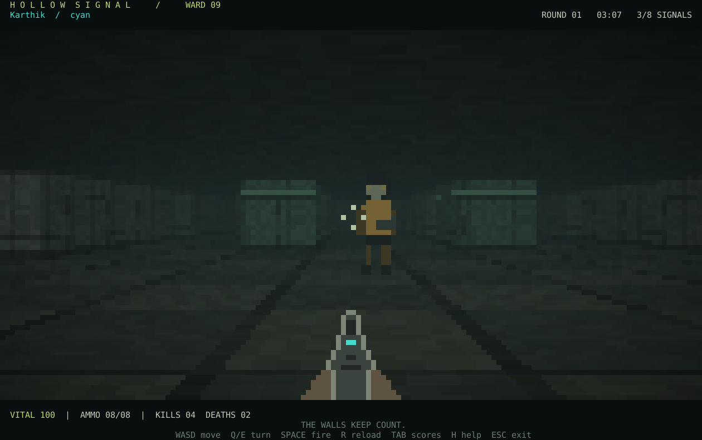

# HOLLOW SIGNAL

**A fog-soaked, full-terminal FPS for 2–8 people on the same LAN.**

You are signals trapped in Ward 09. Walk the corridors, pick out coloured silhouettes through the fog, and survive a five-minute deathmatch. The ward keeps your score until it resets everything.

This is a playable **v0.1 prototype**, with real networking and a server-controlled simulation. It is a Wolfenstein-style **2.5D raycaster**, not a full 3D engine. All graphics are drawn in the terminal using Ratatui and two RGB pixels per character cell.



The preview uses a staged game snapshot, not a recording of a live match.

## What is included

- Host-and-play, join-by-IP, and headless dedicated-server modes.
- Up to 8 players; enter your name and choose from 8 character colours.
- A shared, enclosed arena with textured walls, perspective floors, coloured pixel sprites, distance fog and soft peripheral darkness.
- Psychological-horror atmosphere: abandoned rooms, muted colours, occasional unsettling messages, slow haze and low-health tint.
- Movement, strafing, turning, collision, hitscan shooting, hit markers, ammunition, reloads, deaths and respawns.
- Server-enforced movement speed, shot cooldown, damage, scores and round duration.
- 1 kill = 1 point. Every 300 seconds, all kills/deaths reset, players respawn, and a new round starts. The previous result appears briefly during the next round.
- Ties are reported as ties. Joining mid-round does not reset the clock. The first player entering an empty server starts a fresh five-minute countdown.
- A scoreboard and field manual; connection-loss detection; terminal cleanup on normal exit and panic.

## Windows / PowerShell: start here

1. Install stable Rust using the official installer at <https://rustup.rs/>. On Windows, complete the installer's C++ build-tools prerequisite if requested. Restart PowerShell after installation.
2. Extract this ZIP. Open **Windows Terminal with PowerShell**, then change into the folder containing `Cargo.toml`.
3. Build once:

   ```powershell
   cargo build --release --locked
   ```

4. Run the guided menu:

   ```powershell
   .\target\release\hollow-signal.exe
   ```

Choose **H** to host and play or **J** to join. Enter a name, colour and, when joining, the host's LAN address.

The first build downloads dependencies and needs internet. Once built, matches use only your local network. No accounts, external game server or API keys are needed.

### Host a game directly

On your computer:

```powershell
.\target\release\hollow-signal.exe host --name Karthik --color cyan
```

Before playing, run `ipconfig` and find the active Wi-Fi/Ethernet adapter's **IPv4 Address**, for example `192.168.1.10`. Share that address with your friend.

If Windows Firewall asks, allow the executable on your **private network**. The game uses **UDP 35353**. It does not need a router port-forward for same-LAN play.

### Join from another computer

Your friend needs the same project version built on their computer, or a copy of the executable built for the same OS/architecture. Connect both computers to the same LAN, then run:

```powershell
.\target\release\hollow-signal.exe join 192.168.1.10 --name Arun --color violet
```

Replace `192.168.1.10` with the real host IPv4 address. `127.0.0.1` works only when the host and client run on the **same computer**.

For a quick local test, open two terminal windows: run `host` in the first and `join 127.0.0.1 --name Friend --color amber` in the second. Both appear in the scoreboard. There are no bots in this version.

### Development shortcut

```powershell
cargo run --release --locked -- host --name Karthik --color cyan
cargo run --release --locked -- join 192.168.1.10 --name Arun --color violet
```

The `--` separates Cargo's options from game options.

## Linux / macOS

Install Rust from <https://rustup.rs/>, then:

```sh
cargo build --release --locked
./target/release/hollow-signal
```

Use a true-colour terminal with a monospace font and the `▀` half-block glyph. A terminal supporting key-release events gives better simultaneous-key control. The game detects enhanced keyboard support; unsupported terminals use a short key pulse, which can stutter while a held key waits for OS repeat. The help overlay reports the active input mode. Short repeated taps remain usable.

## Controls

| Key | Action |
|---|---|
| W / S or Up / Down | Forward / backward |
| A / D | Strafe left / right |
| Q / E or Left / Right | Turn left / right |
| Space / Enter / left click | Shoot |
| R | Reload |
| Tab | Toggle scoreboard |
| H or ? | Toggle field manual |
| F | Toggle atmospheric text, animated haze and muzzle effect |
| Esc / Ctrl+C | Leave game |

Use `--calm` to start with reduced atmospheric effects. Distance fog and low-health tint remain, so sightlines are consistent. Use `--fps 60` for up to 60 terminal draws per second; the server always simulates at 30 Hz. Default rendering is 30 FPS. Actual performance depends on terminal size and terminal software.

The game takes over the terminal's entire drawing area. Maximise the terminal window yourself for a desktop-filling view. **120×40 cells or larger** is recommended; minimum is 60×22. Extremely large windows cap the rendered view at 240×90 cells to limit output. Menus do not pause the round, and your character can still be shot.

The play client explicitly enables colour output even when `NO_COLOR` is set: its foreground/background colours are the scene pixels, not optional text decoration.

Colours: `cyan`, `amber`, `violet`, `red`, `lime`, `blue`, `pink`, `white`. Colours need not be unique. Names allow ASCII letters, numbers, spaces, underscores and hyphens, up to 16 characters.

## Combat rules

- 100 health, 34 damage per hit: three hits eliminate a full-health target.
- 8 shots per magazine, unlimited reserve; reload takes 1.4 seconds.
- Shooting an empty magazine starts automatic reload. Shot cooldown: 0.38 seconds.
- Respawn after 2.5 seconds at an available spawn selected for distance from living players.
- Two seconds of spawn protection; firing cancels your own protection. A protected character still blocks a shot.
- Walls block shots. Targets behind the nearest character do not receive the same shot.
- Players may pass through one another; player-to-player movement collision is not implemented.
- Kill count determines the winner. Deaths only order tied players visually; equal kill counts are announced as a tie.

## Dedicated server / custom port

```powershell
.\target\release\hollow-signal.exe server --bind 0.0.0.0:35353
.\target\release\hollow-signal.exe join 192.168.1.10:35353 --name Karthik
```

`host` starts a server and a player in the same process. Closing that host ends the match. `server` runs without graphics, and players join separately. Stop a dedicated server with Ctrl+C. A custom port must be supplied to both host/server and join.

## Troubleshooting

**No host response:** verify the host is running, the IP and port match, both devices are on the same network, and the host firewall allows UDP 35353. Guest Wi-Fi, AP isolation and some corporate networks block device-to-device traffic even on the same SSID. There is no automatic server discovery in v0.1.

**Address already in use:** another server is using the port. Stop it or choose a different `--bind` port.

**Holding keys stutters:** press H to check the input mode. Legacy terminals often do not deliver key-release events. Try Windows Terminal on Windows or an enhanced-keyboard terminal on Unix; use short taps as a fallback. Mouse aiming is not implemented.

**Tiny graphics / resize message:** maximise the terminal or reduce font size. Use a font with the half-block glyph. This is a terminal game; it does not open a separate graphics window.

**No sound:** v0.1 has visual atmosphere only. Audio, bots, multiple maps, matchmaking, persistent profiles, lag compensation and a Bevy renderer are not implemented.

**Host disappears:** clients report loss after five seconds. Return to the menu by restarting the executable and join again; automatic reconnection and host migration are not implemented.

## Development and verification

```sh
cargo fmt --check
cargo test --locked
cargo clippy --locked --all-targets -- -D warnings
cargo build --release --locked
```

See [the architecture and learning guide](docs/ARCHITECTURE.md) and [verification record](docs/VERIFICATION.md).

This prototype is for trusted LAN games. Random session tokens, packet limits, sequence checks and server-side simulation help with accidental or basic forged input; the protocol is unencrypted and is not a hardened public internet game service. All clients receive all player positions, so wallhacks are possible in a modified client.

## Why Ratatui rather than Bevy?

Ratatui draws the terminal interface; Crossterm handles the terminal and input. A compact raycaster provides the first-person view without a graphics window. Bevy is a sensible later client if you want GPU lighting, audio, free mouse-look, vertical aiming and true 3D. Keep this simulation/protocol as a separate shared crate if you make that transition; a new renderer alone does not add those game mechanics.

Primary references used for the selected API versions:

- <https://ratatui.rs/installation/>
- <https://docs.rs/crossterm/0.29.0/crossterm/event/struct.KeyEvent.html>
- <https://docs.rs/ratatui/0.30.2/ratatui/buffer/struct.Buffer.html>

MIT licensed. All included sprites, arena and textures were authored as code for this project.

